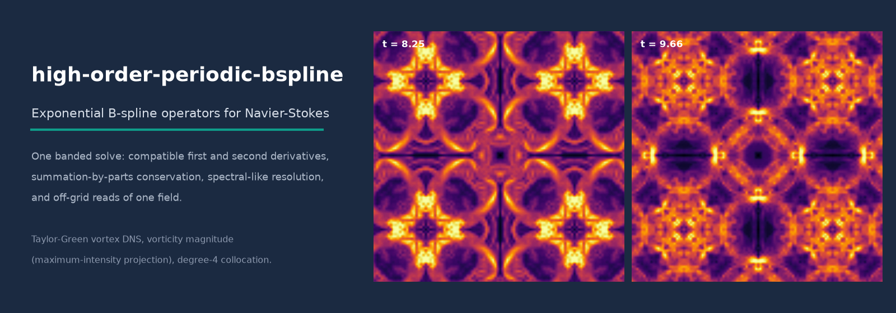
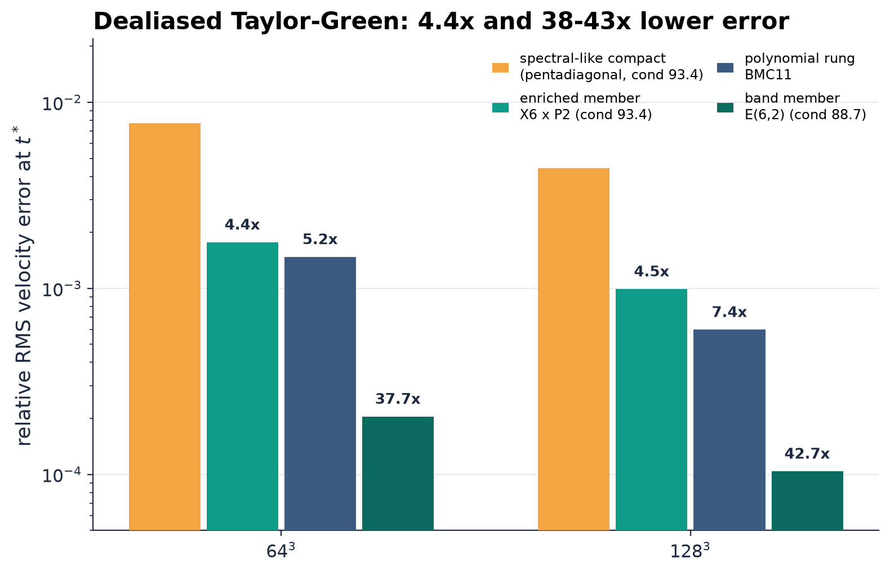
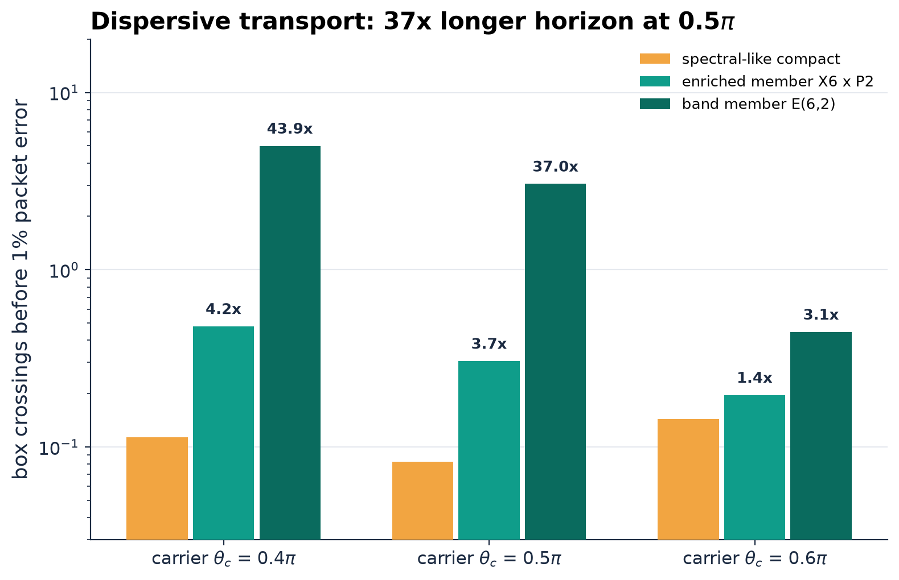
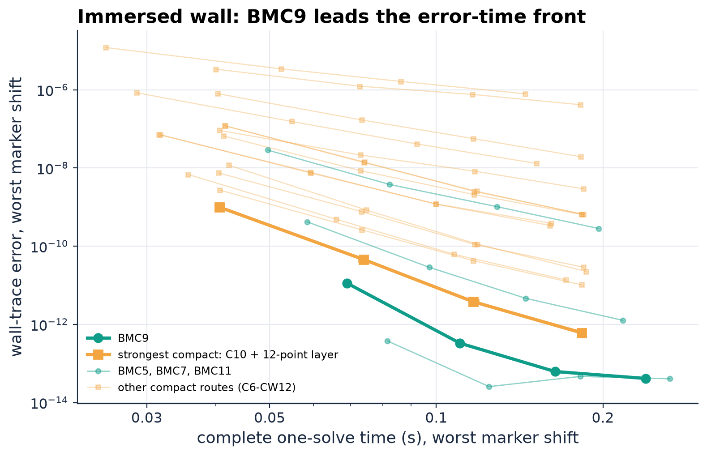
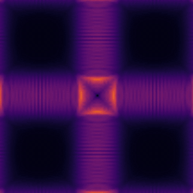

<p align="center">
  
</p>

# high-order-periodic-bspline

[](https://github.com/bay-yearick-lab/high-order-periodic-bspline/actions/workflows/tests.yml)
[](LICENSE)
[](pyproject.toml)
[](code/solver/)

Yong Yi Bay and Kathleen A. Yearick

## Overview

High-order CFD usually buys short-wave resolution, exact discrete conservation and accurate values between grid points from three separate devices: an optimized compact stencil, a split convective form with a summation-by-parts (SBP) norm, and an interpolation layer. Here one periodic exponential cardinal B-spline field supplies all three from a single banded solve. The nodal first and second derivatives are $D_1 = B'B^{-1}$ and $D_2 = B''B^{-1}$, where $B$, $B'$, $B''$ are the banded circulant lattice samples of the generator, and the same coefficients evaluate the field and its derivatives anywhere in the cell.

The generator is a product of first-order factors, so its degree splits into dials. A polynomial core of multiplicity $m$ sets the formal order and the decay of the alias tail; $r$ conjugate imaginary exponent pairs $\pm i\omega_j$ plant exact contacts of the modified wavenumber inside the band the solver resolves; a transform polynomial adds a third dial that costs no bandwidth. An alias-average representation of the modified wavenumber bounds the band error, prices the conditioning each dial spends, and turns frequency selection into a Remez equioscillation problem. The published spectral-like compact derivative and an eighth-order tridiagonal pair are realized exactly as members of the family.

Every admissible member inherits the fully conservative periodic incompressible Navier-Stokes semidiscretization: a skew-symmetric SBP first derivative, fixed-radius local flux balances, energy-neutral skew-symmetric convection, gradient-divergence adjointness, and a self-adjoint nonpositive second derivative. The same operators drive a compressible solver whose split skew-symmetric convection conserves mass, momentum and total energy to round-off. Accuracy is measured against the strongest comparator at matched conditioning or matched time, inside evolved flows, with matrix-free banded line solves in a C++17/OpenMP solver.

## Results

| Evaluation | Result |
| --- | --- |
| Dealiased Taylor-Green, Re = 1600, matched truncation, $64^3$ and $128^3$ | enriched member $X_6 \times P_2$: **4.37x and 4.48x** lower velocity error than the fourth-order pentadiagonal spectral-like compact scheme at the same left-side condition number (93.4); band member $E_{6,2}$: **37.7x and 42.7x** lower |
| Long-horizon dispersive transport, $N = 128$ | band member travels **37.0x** (carrier $0.5\pi$) and **43.9x** ($0.4\pi$) more box crossings before 1% packet error; closed form agrees with SSP-RK3 time stepping to 6.0e-11 |
| Immersed smooth wall, periodic Helmholtz, $N$ = 96 to 192, 4 marker shifts | BMC9 cuts the worst-shift wall-trace error **62.71x** and the exterior-field error **32.17x** against the strongest compact route (C10 with a 12-point evaluation layer), at **1.70x and 1.76x** the complete one-solve time; BMC9 wins all 72 exact comparisons per metric; 464 of 464 runs pass every discrete invariant |
| Nodal yardsticks at equal conditioning (93.37) | enriched member exceeds the spectral-like compact pair on every nodal yardstick from one field: resolving reach at $10^{-4}$ is $0.382\pi$ against $0.231\pi$ (+66%), first-derivative band maximum 4.41e-4 against 6.58e-4 |
| Off-grid reads at the band edge, $N$ = 48 to 256 | value, first and second derivative read from one coefficient field: 55x to 290x below the compact route plus 12-point interpolation; band member a further 5.6x to 13x below |
| Semi-Lagrangian transport on fewer points | minimum admissible grid 32 against 48 to 64 points ($K = 12$ packet) and 56 to 64 against 96 to 128 ($K = 24$ packet); mission time 5.3% to 6.1% of the compact route |
| Periodic SBP and degree-shift identity | $HD + D^\top H = 0$ to 6.6e-17 relative for BMC2 to BMC11 and BMG1 to BMG5; $\mathrm{BMC}_{2p+1} = \mathrm{BMG}_p$ entrywise, residual exactly 0 |
| Convergence ladder | observed first-derivative order 2.03, 4.02, 4.08, 6.05, 6.15, 8.09, 8.24, 10.06 for BMC2 to BMC9, formal order $2\lceil p/2 \rceil$ |
| Compressible split skew-symmetric solver | after 300 SSP-RK3 steps: mass 1.1e-14, momentum 1.2e-17, total energy 3.6e-14; convective kinetic-energy rate 5.3e-19 relative |
| Isentropic vortex, compressible Euler | observed order 2.26, 5.35, 7.88 for $p$ = 2, 4, 6 (formal 2, 4, 6); viscous MMS 2.0, 4.1, 6.1; full Euler RHS MMS 2.0, 4.1, 6.2 |
| Wall time per step, C++ Taylor-Green solver, $128^3$ | band member 1.05 s against 1.21 s for the spectral-like compact scheme (0.87x) |
| Matrix-free banded line derivative, $128^3$ field, one thread | BMC9 reaches 2.0e-14 relative error at 1.29x the time of the sixth-order tridiagonal compact scheme (1.2e-9); operator storage 14 kB against 131 kB for one dense $N \times N$ matrix |

<p align="center"></p>

**Figure 1.** Operator fidelity inside an evolved flow. Every route integrates the same 2/3-dealiased Navier-Stokes system for the Taylor-Green vortex at Re = 1600 to $t^* = 9.0026$ (CFL 0.2), so the error against the same-grid dealiased Fourier pseudospectral solution is the spatial operator error alone. Labels give the error reduction over the spectral-like compact scheme. Data: `results/exponential_family/gate9/e2_decision*.json`.

<p align="center"></p>

**Figure 2.** Dispersive transport horizon. Number of periodic-box crossings before a translated broadband packet accumulates 1% phase error, at three carrier wavenumbers, $N = 128$. The horizon follows from the modified-wavenumber symbol in closed form; a time-stepped SSP-RK3 run on the assembled circulant matches it to 6.0e-11. Data: `results/exponential_family/gate9/e3_transport_core6.json`.

<p align="center"></p>

**Figure 3.** Accuracy against cost for an immersed smooth wall. Periodic 2D Helmholtz problem with direct-forcing marker multipliers solved through the Schur complement; each point is one route at one grid ($N$ = 96, 128, 160, 192), taking the worst of four marker shifts for both error and complete one-solve time (setup, evaluator construction, Schur assembly and solve). BMC9 leads the front of every banded compact route. Data: `results/ibm_cert/full_results.csv`.

<p align="center"></p>

**Figure 4.** Transition of the Taylor-Green vortex: vorticity magnitude (maximum-intensity projection) from the C++ solver with degree-4 periodic B-spline collocation, skew-symmetric convection and a projection step.

## Verification

```bash
make verify          # or: uv run python tools/verify.py
```

Part A recomputes the identities and the convergence ladder live; part B re-derives the evolved-flow, transport and wall numbers from the receipts in `results/`. Expected output (under a second):

```text
A1. Discrete identities on a periodic grid, N = 64
   BMC_(2p+1) = BMG_p, first and second derivative, p = 1..5   max |diff| = 0.0e+00  ok
   SBP  H D + D^T H = 0, BMC2..BMC11 and BMG1..BMG5           rel. residual = 6.6e-17  ok
   H D2 symmetric, 15 operators                                rel. residual = 2.5e-17  ok
   <D2 u, u>_H <= 0 on zero-mean fields                        max = -5.64e+03  ok

A2. First-derivative convergence, u = sin 2x + cos(3x)/2, max norm, N = 48 -> 64
    degree p   formal order 2*ceil(p/2)   observed
    BMC2        2                          2.03   ok
    BMC3        4                          4.02   ok
    BMC4        4                          4.08   ok
    BMC5        6                          6.05   ok
    BMC6        6                          6.15   ok
    BMC7        8                          8.09   ok
    BMC8        8                          8.24   ok
    BMC9       10                         10.06   ok

B1. Dealiased Taylor-Green, Re = 1600, t* = 9.0026: relative RMS velocity error against the
    same-grid dealiased Fourier pseudospectral solution (spatial operator error alone)
    route                                   64^3        128^3      gain over spectral-like compact
    spectral-like compact (pentadiagonal)   7.725e-03   4.435e-03    1.00x,  1.00x
    enriched member X6 x P2                 1.769e-03   9.911e-04    4.37x,  4.48x
    polynomial rung BMC11                   1.476e-03   5.996e-04    5.23x,  7.40x
    band member E(6,2)                      2.048e-04   1.039e-04   37.73x, 42.68x

B2. Long-horizon dispersive transport, N = 128: crossings of the periodic box before the
    packet error reaches 1 percent (closed form, checked against SSP-RK3 to 6e-11)
    carrier theta_c     spectral-like compact   enriched member   band member E(6,2)
    0.4 pi                 0.114               0.480 (4.21x)    4.992 ( 43.9x)
    0.5 pi                 0.082               0.305 (3.70x)    3.049 ( 37.0x)
    0.6 pi                 0.143               0.196 (1.37x)    0.446 (  3.1x)

B3. Immersed smooth wall, periodic Helmholtz with Schur-complement marker coupling, N = 96..192,
    four marker shifts: BMC9 against the strongest compact route (C10 + 12-point evaluation layer)
    worst-shift error reduction: wall trace 62.71x, exterior field 32.17x
    complete one-solve time ratio: 1.70x and 1.76x
    runs with every discrete invariant passing: 464 / 464

PASS  (0.11 s)
```

`make test` runs 38 numerical validation tests (`tests/test_validation.py`: SBP and degree-shift identities to round-off, self-adjoint nonpositive $D_2$ with constants as its only kernel, energy-neutral skew convection, formal orders) and 306 regression tests of the family, evaluator, Remez rule, compact-class ceiling, transport and off-grid studies (`code/tests/`); 344 pass in about a minute. `make solver-test` builds the C++ compressible verification suite; its output is stored in `results/compressible/mms_compressible_output.txt`.

## Method

**Generator.** The member $E_{m,r}(\omega)$ has exponent multiset $(0^m, \pm i\omega_1, \dots, \pm i\omega_r)$, degree $p = m + 2r - 1$, and transform

$$\hat\phi(\xi) = \mathrm{sinc}(\xi/2)^m \prod_{j=1}^{r} \frac{\mathrm{sinc}\big((\xi-\omega_j)/2\big)\,\mathrm{sinc}\big((\xi+\omega_j)/2\big)}{\mathrm{sinc}(\omega_j/2)^2}.$$

With $r = 0$ it is the cardinal B-spline of degree $p$, and the route is BMC$_p$ (B-spline mimetic collocation). Polynomial augmentation $E_{m,r} \times P_q$ multiplies the transform by an even polynomial without widening the support.

**Alias-average symbol.** Poisson summation gives the nodal symbols as alias-weighted averages of true wavenumbers,

$$\kappa_1(\theta) = \frac{\sum_k (\theta + 2\pi k)\,\hat\phi(\theta + 2\pi k)}{\sum_k \hat\phi(\theta + 2\pi k)}, \qquad \kappa_2(\theta) = \frac{\sum_k (\theta + 2\pi k)^2\,\hat\phi(\theta + 2\pi k)}{\sum_k \hat\phi(\theta + 2\pi k)},$$

so each exponent pair forces $\kappa_1(\omega_j) = \omega_j$ exactly, the core multiplicity sets the alias-tail decay, and the band maximum of $|\kappa_1/\theta - 1|$ is minimized by equioscillation (Remez exchange). The compact class of each formal order has the same parameter count as the family, which is why the published spectral-like and tuned compact schemes appear as members.

**Discrete conservation.** On the periodic uniform grid $B$ is symmetric circulant and $B'$ skew-symmetric circulant, so $D_1$ is skew-adjoint in the norm $H = hI$, $D_2$ is self-adjoint and nonpositive with constants as its only kernel, and the degree-shift identity $\mathrm{BMC}_{2p+1} = \mathrm{BMG}_p$ links collocation to Galerkin entrywise. Skew-symmetric convection then injects no kinetic energy, and the pressure gradient and velocity divergence are discrete adjoints.

**Solver.** Every 3D operator collapses to independent 1D cyclic banded line solves along each axis (OpenMP across lines). The incompressible solver uses skew-symmetric convection, a projection step with a separable pressure solve, SSP-RK3 time stepping and an optional route-agnostic 2/3 dealiasing filter. The `exp` route reads a member's lattice samples $\beta, \beta', \beta''$ from JSON at run time, so one binary fields every member without a rebuild (`code/solver/EXP_ROUTE.md`). The compressible solver advances conservative variables with the fully split skew-symmetric convective form. An independent Fourier pseudospectral solver in PyTorch (`torch.fft`, float64, GPU when available) provides the dealiased reference fields.

## Where things live

| Component | File |
| --- | --- |
| Cardinal B-spline samples, BMC/BMG operators, SBP norm, symbols, off-grid evaluation | `code/spline_analysis.py` |
| Exponential generator $E_{m,r}(\omega)$, alias-average symbols, conditioning | `code/analysis/exponential_family/family.py` |
| Polynomial-augmented family $E_{m,r} \times P_q$, exact realization of compact schemes | `code/analysis/exponential_family/gate8_family.py`, `gate8_realization.py` |
| Remez equioscillation frequency rule; band-minimax members | `code/analysis/exponential_family/gate2_rule.py`, `gate1_champions.py` |
| Compact-class ceiling (linear program with dual certificate), dominance search | `code/analysis/exponential_family/gate7_ceiling.py`, `gate8_dominance.py` |
| Nodal yardstick battery for any generator | `code/analysis/exponential_family/static_battery.py`, `metrics.py`, `comparators.py` |
| Pointwise evaluator for off-grid value, first and second derivative | `code/analysis/exponential_family/evaluator.py`, `general_evaluator.py`; C++ `code/solver/exp_eval.h` |
| Member JSON writer and C++ reader | `code/analysis/exponential_family/write_member.py`, `code/solver/exp_member.h` |
| Cyclic banded LU and line solvers | `code/solver/linalg.h` |
| Matrix-free derivative application (reduce-solve-expand) | `code/solver/bm_apply.h`, `code/solver/bm3d.h` |
| Incompressible Navier-Stokes, projection, separable pressure solve | `code/solver/ns.h`, `code/solver/poisson.h` |
| Compressible split skew-symmetric Navier-Stokes and its verification | `code/solver/compressible.h`, `code/solver/mms_compressible.cpp` |
| Taylor-Green driver; matched-truncation analysis | `code/solver/tgv_re1600.cpp`; `code/analysis/exponential_family/gate4e_matched_truncation.py`, `gate9_e2.py` |
| Fourier pseudospectral reference (PyTorch GPU, NumPy) | `code/solver/ps_reference.py`, `code/solver/ps_reference_numpy.py` |
| Long-horizon transport | `code/analysis/exponential_family/gate4b_long_horizon.py`, `gate9_e3.py` |
| Off-grid and semi-Lagrangian studies | `code/analysis/exponential_family/gate5a_offgrid.py`, `gate5b_semilagrangian.py`, `gate9_e4.py`, `gate9_e5.py` |
| Immersed wall: Helmholtz with Schur-complement coupling, certified run matrix | `code/experiment_ibm.py`, `code/experiment_ibm_frontier.py`, `code/analysis/ibm_cert/` |
| Structural identity checks (SBP, local flux balance, skew convection, pressure work) | `code/check_*.py`, `code/s7_*.py` |
| Headline verification, validation tests, figures | `tools/verify.py`, `tests/test_validation.py`, `tools/make_readme_assets.py` |

## Layout

```text
code/
  spline_analysis.py           operator library (Python)
  analysis/exponential_family/ generator, evaluator, Remez rule, ceilings, studies
  analysis/ibm_cert/           immersed-wall run matrix and reduction
  solver/                      C++17/OpenMP Navier-Stokes solver, header-only operators
  tests/                       regression tests
  experiment_*.py, fig_ef_*.py figure and study drivers
results/
  exponential_family/          machine-readable receipts (JSON, CSV) and member files
  ibm_cert/                    immersed-wall results and certificates
  compressible/                compressible verification output
tests/                         numerical validation (pytest)
benchmarks/                    line-derivative accuracy and cost; solver step timings
tools/                         verify.py, make_readme_assets.py
assets/                        README figures
```

## Building and reproducing

```bash
uv sync                      # Python 3.11+, pinned by uv.lock
make verify                  # headline numbers
make test                    # 344 tests
make bench                   # benchmarks/results/
make figures                 # assets/*.png from results/
make solver                  # C++ drivers (g++ >= 9, OpenMP)
make solver-test             # compressible conservation and convergence orders
```

Fielding a member in the Taylor-Green solver:

```bash
OMP_NUM_THREADS=4 code/solver/tgv_re1600 128 exp 1600 9.00262644794325 9 0.2 \
    9.00262644794325 twothirds - --exact-time \
    --exp-member results/exponential_family/members/E62_champion.json
```

## Citation

```bibtex
@article{bay2026periodic,
  author = {Bay, Yong Yi and Yearick, Kathleen A.},
  title  = {Periodic Exponential Cardinal {B}-Splines with Three Dials: Two Compact Schemes
            Realized as Members, and One Banded Solve for Resolution, Conservation,
            and Off-Grid Coupling},
  year   = {2026}
}
```

## License

MIT. See [LICENSE](LICENSE).
